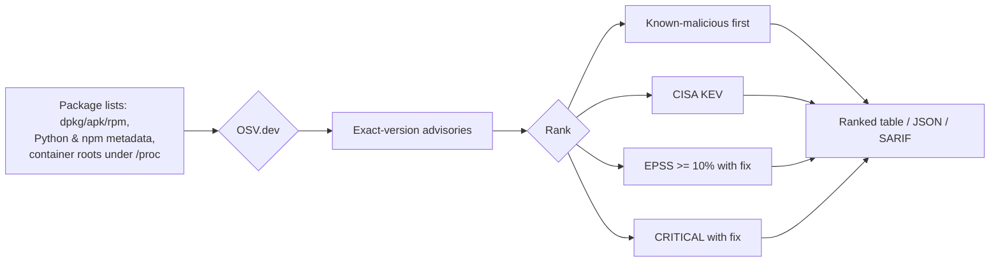

# sieve

Find the CVEs that matter on a Linux box and its running containers, plus the weak passwords and plain-text secrets left lying around it.


[](https://github.com/casareanderson/sieve/actions/workflows/ci.yml)
[](LICENSE)
[](https://github.com/casareanderson/sieve/releases/latest)

No scanner binary, no 1.4 GB database, no server: sieve reads the package lists already on the box, asks
[OSV.dev](https://osv.dev) which advisories affect those exact versions, then ranks the results by
[CISA KEV](https://www.cisa.gov/known-exploited-vulnerabilities-catalog) and [EPSS](https://www.first.org/epss/).
Its only dependency is `requests`.

## Contents

- [What it does](#what-it-does)
- [Screenshots and demo](#screenshots-and-demo)
- [Quick start](#quick-start)
- [Usage](#usage)
- [Configuration](#configuration)
- [How it works](#how-it-works)
- [Status and limits](#status-and-limits)
- [Benchmark](#benchmark)
- [Development](#development)
- [Licence and credits](#licence-and-credits)

## What it does

- Reads the package lists already on a machine — dpkg, apk or rpm, plus Python and npm packages outside the OS — and scans running containers through their real filesystem under `/proc`. No binary, no database to patch.
- Asks OSV.dev which advisories affect those exact versions, then ranks them so known-exploited (CISA KEV) and likely-exploited (EPSS) findings come first, and known-malicious packages above everything.
- Flags, per finding, whether the vulnerable code is loaded in a running process right now (`IN USE`), and checks that no installed file has been changed since its package manager put it there (`sieve verify`).
- Scans project directories from lockfiles without running npm, yarn, pip or node, and scans another machine over SSH with nothing installed there.
- Finds default passwords and open admin pages on small boards — ESPHome, WLED and Victron Venus OS — and plain-text secrets in files, shell histories, AI agent chats and container environments.

sieve is a small, purpose-built tool, not a full scanner suite. It is the scanner inside
[warden](https://github.com/casareanderson/warden), which replaced trivy on 10 October 2026 after trivy's v0.69.4
release and its v0.69.5 and v0.69.6 images were malicious (CVE-2026-33634): the scanner you run as root to find
supply-chain problems shouldn't be a supply-chain problem itself. OSV.dev is the open database behind Google's
osv-scanner, and the weekly benchmark below keeps sieve honest against the bigger tools.

## Screenshots and demo


## Quick start

Requires Python 3.10 or newer. It also runs straight from a checkout: `python3 -m sieve host`.

```
pipx install sieve-scan        # on PyPI as `sieve-scan`; the command is `sieve`
brew install casareanderson/tap/sieve   # Homebrew (macOS or Linux), same PyPI release
```

Success looks like this — a ranked table and a one-line summary:

```
$ sieve host --limit 3
# host: debian 13, 811 packages

ALERT  EPSS  SEVERITY  ID              PACKAGE         INSTALLED → FIXED   TARGET
       73.3%  UNKNOWN   CVE-2011-3389   gnutls-bin      3.8.9-3+deb13u4 → … host
…
1965 findings, 0 actively exploited, 0 fixable
```

Full step-by-step setup, tested every week on a fresh machine: [docs/SETUP.md](docs/SETUP.md).

Docker (the image only needs to read the host filesystem, so mount it read-only and point `--root` at it):

```
docker run --rm -v /:/host:ro ghcr.io/casareanderson/sieve host --root /host
```

Add `-v sieve-cache:/home/sieve/.cache` to keep the advisory cache between runs. The image runs as an
unprivileged user; package databases are world-readable, so host scans don't need root. The image can't scan
running containers itself — that needs the docker CLI and root on the Docker host — so run the collector there
(it is standard-library Python) and pipe its output into the image:

```
docker run --rm ghcr.io/casareanderson/sieve collector | sudo python3 - \
  | docker run --rm -i ghcr.io/casareanderson/sieve containers --from-tar -
```

## Usage

```
sieve host          # this machine: dpkg, apk or rpm packages, Python packages pip installed outside the OS, global npm
sieve containers    # every running Docker container on this machine (needs root)
sieve all           # both
sieve path DIR ...  # project directories: lockfiles, node_modules, requirements, virtualenvs (see below)
sieve verify        # has any installed file changed since its package manager put it there? (see Verify)
sieve remote user@host   # another machine over ssh: what `sieve all` would find there, nothing installed there
sieve sbom FILE ...      # scan SBOMs made by other tools (CycloneDX or SPDX JSON; see SBOM)
sieve devices [HOST ...] # ESPHome, WLED and Victron Venus OS boards on the network: firmware advisories + open OTA/API/web UI
sieve secrets [DIR ...]  # plain-text credentials: files, shell histories, AI agent chats, container environments (see Secrets)
sieve diff OLD.json NEW.json   # what is new in a saved --json report, and what has gone (see Only what's new)
```

Options (for `host`, `containers`, `all`, `path`, `remote`, `sbom` and `devices`):

| option | what it does |
|---|---|
| `--json` | machine-readable output |
| `--sarif` | SARIF 2.1.0 output for GitHub code scanning (see Code scanning) |
| `--sbom cyclonedx\|spdx` | print an SBOM of what was read instead of scanning it (see SBOM) |
| `--with-vulns` | with `--sbom cyclonedx`: scan as usual and add the findings to the SBOM |
| `--min-severity low\|medium\|high\|critical` | hide findings below this severity |
| `--cache PATH` | advisory cache, default `~/.cache/sieve/sieve.db`; the KEV and EPSS files are kept next to it |
| `--no-epss` | don't download or use EPSS scores |
| `--kernel` | also check kernel packages (skipped by default, see Limits) |
| `--root PATH` | `host` and `all`: read the host's packages from this directory instead of `/` |
| `--new` | only findings new since the last `--new` run of the same scan, plus what has gone (see Only what's new) |
| `--baseline FILE` | with `--new`: where to keep the last run, default next to the cache |
| `--limit N` | table rows to print, default 50, `0` for all |
| `--depth N` | `path`: how deep to look under each directory, default 8 |

`--kev-only` (only CISA known-exploited), `--fixable-only` (a fixed version exists) and `--in-use-only` (code loaded
in a running process) are filters to the same scan.

Exit codes: `1` if any known-malicious package or known-exploited (KEV) finding is in the output, `2` if part
of the scan failed, otherwise `0`. Filters apply first, so a KEV/malicious finding is only raised if it survives
them; a malicious package is never hidden by a filter.

### Only what's new

A daily job that prints the same 1,200 findings every morning gets ignored. `--new` keeps the last run of the
same scan and shows only what has changed:

```
sieve host --new           # first run: everything is new, and it is saved as the baseline
sieve host --new           # next day: only findings that weren't there yesterday, then what has gone
```

- A finding is the same while its target, package and advisory id match. Upgrading to a version that is still
  vulnerable is not "new".
- "Gone" means fixed or removed: the package was upgraded past the fix, or it is no longer there.

To compare two reports you saved yourself, run `sieve diff monday.json tuesday.json`: the new and gone findings,
`--json`, and exit `1` if a new one is known-exploited or malicious.

### Project directories and malicious packages

`sieve path` scans what a project has pinned or installed, without running npm, yarn, pnpm, pip or node:

| file | what is read |
|---|---|
| `package-lock.json`, `npm-shrinkwrap.json` | every package, lockfile versions 1, 2 and 3 |
| `yarn.lock` | classic (v1) and berry (v2+); workspace and link entries skipped |
| `pnpm-lock.yaml` | lockfile versions 5, 6 and 9 |
| `node_modules/` | every installed `package.json`, nested ones included |
| `requirements*.txt` | `name==version` pins (ranges can't be matched to one version) |
| `poetry.lock`, `uv.lock` | every `[[package]]`; your own editable or path projects skipped |
| `site-packages/` | `*.dist-info` metadata, so a virtualenv inside the project is covered |

`.git` is never read. A lockfile sieve can't parse (a pnpm `lockfileVersion` it doesn't know, broken JSON) is
named in the output and marks the scan partial, instead of looking like a clean project.

**Known-malicious packages come first.** OSV carries the OpenSSF malicious-packages feed (`MAL-` ids), and GitHub
files planted malware as CWE-506. A package that matches is not a bug with a patch: someone put code there on
purpose. sieve ranks it above everything else, shows it as `☠ MALWARE`, folds the duplicate records into one row,
exits `1`, and in SARIF reports it as `error` with a security-severity of 10.0:

```
$ sieve path ./demo
# path:/demo: project files, 2 packages  (read 1 package-lock.json)

ALERT      EPSS  SEVERITY  ID              PACKAGE         INSTALLED → FIXED             TARGET
☠ MALWARE  -     CRITICAL  MAL-2025-20690  flatmap-stream  0.1.1 → malicious: remove it  path:/demo

1 MALICIOUS PACKAGE (remove it, rotate secrets), 1 findings, 0 actively exploited, 0 fixable
```

(`flatmap-stream` 0.1.1 is the 2018 event-stream backdoor. The lockfile only names it; nothing was installed.)
If you find one: remove it, rebuild from a clean lockfile, and rotate every secret the machine or CI job could read.

### Verify

`sieve verify` asks a different question from the CVE scan: **has any installed file been changed since its
package manager put it there?** A vulnerability list can't see a swapped `sshd` or an edited library whose version
number stayed the same. Every package manager already keeps a checksum for each file it installs, so sieve re-hashes
the files and compares — no binary, no download, no root for the host (unreadable files are counted and named in the
output). In this example, one byte was appended to `sha256sum` for the demo:

```
sieve verify                              # this machine
sieve verify --root /mnt/image            # a mounted filesystem or an exported image
sudo sieve verify --containers [--host]   # every running Docker container, read in place
sieve verify --packages openssh-server,sudo
```

| system | checksums read | algorithm |
|---|---|---|
| Debian, Ubuntu | `/var/lib/dpkg/info/<pkg>.md5sums` | MD5 |
| Alpine | `/lib/apk/db/installed` (`Z:` lines) | SHA-1 |
| rpm (AlmaLinux, Rocky, RHEL, openSUSE, Fedora) | the rpm database's own headers (FILEDIGESTS) | SHA-256 on current releases, MD5 on old ones |
| Python (pip) | `*.dist-info/RECORD` | SHA-256 |
| npm | **nothing to check**: npm keeps no checksum for installed files (a lockfile's `integrity` hashes the downloaded tarball, not what is on disk) | |

```
$ sieve verify --root ./rocky-9-minimal
# host (./rocky-9-minimal): rocky 9.8, 118 packages, 4038 files  (76 config files skipped; …; rpm checked in 0.6s)

STATE       PACKAGE                       FILE                TARGET
changed  ⚠  coreutils-single 8.32-40.el9  /usr/bin/sha256sum  host (./rocky-9-minimal)

1 changed (1 security-critical), 0 missing, 4038 files checked
```

(That image had one byte appended to `sha256sum` for the demo.) What it reports:

- **changed**: the file's content differs from the checksum its package recorded. `/usr/bin`, `/usr/sbin`, `/bin`,
  `/sbin`, PAM modules, `sshd`, `sudo`, `su`, `login`, the C library and the dynamic loader are ⚠ security-critical
  (SARIF `error`); other changed files are `warning`.
- **missing**: a file the package installed is gone. Minimal and official images delete docs and man pages after
  install; those count as *trimmed* and aren't listed (`--all-missing` lists them).
- **not checked by design**: dpkg `path-exclude`, rpm files never installed (nodocs, other languages, the other
  multilib architecture) and rpm files the package marks `%verify(not md5)` because it rewrites them itself
  (glibc's `gconv-modules.cache`).
- **config files** are meant to change, so dpkg conffiles and rpm `%config` files are skipped unless you pass
  `--include-config`. Debian's `/usr` merge diversions and container mount points are handled, and inside a
  container root an absolute symlink is followed within the container.

Exit codes: `1` if a packaged file changed, `2` if nothing could be checked, otherwise `0`. Missing files are
reported but don't fail the run; `--json` and `--sarif` work as for the scan.

**It's a tripwire, not proof.** MD5 and SHA-1 catch accidental changes and failed upgrades, but anyone with root
can rewrite the checksum lists as easily as the files.

### Passwords and small boards

`sieve host` and `sieve remote` also check how the machine can be logged into, with ids starting `SIEVE-` that work
with every filter, `--new`, `--json` and `--sarif` like any other finding:

| id | severity | what |
|---|---|---|
| `SIEVE-DEFAULT-PASSWORD` | critical | an account still has its board image's default password (`pi`/`raspberry`, DietPi, Armbian, Orange Pi, BeagleBone, Ubuntu for Pi, Jetson, ...) |
| `SIEVE-EMPTY-PASSWORD` | critical | an account has no password at all |
| `SIEVE-ROOT-SSH-PASSWORD` | high | root has a password and sshd lets root log in with it |
| `SIEVE-SSH-EMPTY-PASSWORDS` | high | sshd has `PermitEmptyPasswords yes` |
| `SIEVE-WEAK-PASSWORD-HASH` | medium | a password is stored as DES or MD5 crypt |
| `SIEVE-ROOT-PASSWORD` | low | root's password isn't locked (ssh doesn't take it, but a console, `su` or a PAM web UI does) |

Reading `/etc/shadow` needs root (`sudo sieve host`, `sieve remote root@pi` or `--sudo`); without it the scan says
so and carries on. **No password or hash ever leaves the machine**: the default-password check hashes each known
default with the account's own salt *on the machine being scanned* (libcrypt via ctypes) and reports only the
image name it matched. sshd settings come from `sshd -T` when sieve runs as root there, otherwise from the config
files. 32-bit Raspberry Pi OS (`ID=raspbian`) is scanned against Debian's feed.

`sieve devices` looks at microcontroller boards, which have no package list to read:

```
$ sieve devices                 # mDNS browse for ESPHome and WLED, ~3 s
$ sieve devices 192.0.2.32 192.0.2.176   # plus boards that don't answer mDNS, and Venus OS
# esp:Homelab Watchdog (192.0.2.32): ESPHome (version unknown), 0 packages [partial]  (version unknown: …; api closed, ota password, web open)
# venus:192.0.2.176: Victron Venus OS, 0 packages  (remote console login, modbus closed, mqtt 1883 closed, ssh closed; …)
# esp:Garden Room BT Proxy (192.0.2.187): ESPHome 2026.8.2 on ESP32/esp32dev, 1 packages  (api encrypted, ota password, web closed)
# wled:Kitchen (192.0.2.195): WLED 16.0.1 on esp32, 1 packages  (WLED publishes no security advisories …)

ALERT  EPSS  SEVERITY  IN USE  ID                         PACKAGE           INSTALLED → FIXED                                                      TARGET
       -     HIGH      -       SIEVE-WLED-OTA-UNLOCKED    wled firmware     OTA not locked → Config → Security & Updates: set a settings PIN…      wled:Kitchen (192.0.2.195)
       -     MEDIUM    -       SIEVE-ESPHOME-WEB-NO-AUTH  esphome firmware  web UI without a login → web_server: auth: {username: …, password: …}  esp:Homelab Watchdog (192.0.2…

2 findings, 0 actively exploited, 2 fixable
```

- **ESPHome**: the release that built the firmware (from mDNS, or the API hello when it's unencrypted) is matched
  against OSV's `esphome` advisories. Then it flags: native API without an encryption key, OTA that flashes without
  a password, web UI without a login, and web-UI firmware upload. Nothing is uploaded; the board logs an aborted
  OTA.
- **WLED**: version and chip from `/json/info`, and whether OTA is locked (`/json/cfg`). WLED publishes no
  advisories, so its version is shown but not matched.
- **Victron Venus OS** (Cerbo GX): name it as a HOST. Flags a Remote Console with no login, Modbus TCP on, and
  plaintext MQTT on 1883 (all off in Venus's default "Secured" profile). No firmware advisories to OSV.
- Not yet: Tasmota, Shelly, OpenBeken, and ESP-IDF's own advisories (a board doesn't say which ESP-IDF built it).

### Secrets

`sieve host`, `all`, `containers` and `remote` run the secrets check automatically; `--no-secrets` turns it off.
`sieve secrets` runs it alone, with no advisory lookups. It looks for credentials lying around in plain text. One
row per file or container, however many secrets it holds:

| id | severity | what |
|---|---|---|
| `SIEVE-SECRET-IN-FILE` | low | `.env`, compose files, `.netrc`, `.git-credentials`, `.pgpass`, `.npmrc`, `.pypirc`, cloud, docker and kube credentials, `password=` / `token:` lines in configs under `/etc`, `/opt`, `/srv` and `~/.config` |
| `SIEVE-SECRET-IN-HISTORY` | medium | a password or token typed on a command line (`curl -u`, `mysql -p`, `export X_TOKEN=…`) and kept in a shell history |
| `SIEVE-SECRET-IN-AGENT-CHAT` | medium | a secret in an AI coding agent's chat transcript: Claude Code, Codex, Continue, OpenCode, Hermes, Gemini CLI, Goose, aider. It went to the model provider too, so rotate it |
| `SIEVE-SECRET-IN-AGENT-CONFIG` | low | a token written into an agent or MCP server config (`.mcp.json`, `~/.claude.json`, Cursor, Claude Desktop, Codex …) |
| `SIEVE-SECRET-PRIVATE-KEY` | low | a private key with no passphrase in a home directory |
| `SIEVE-SECRET-IN-CONTAINER-ENV` | low | a running container has a credential in its environment (`docker inspect` shows it to anyone who can run docker) |

Any of them becomes **high** when every user on the machine can read the file (its mode *and* every directory above
it let them through), and at least **medium** when a group other than the owner's own can. A service's own key in
`/etc` that only the service can read is not reported; an agent's own login store (`~/.claude/.credentials.json`,
`~/.codex/auth.json`) only when someone else can read it.

**The secret itself never leaves the function that found it**: not in the output, the JSON, the `--new` baseline,
or the tar `sieve remote` brings back. A row says where (path and first line, or container and variable names), what
kind, the file mode, who can read it, and an 8-hex fingerprint: an HMAC keyed by a random key sieve keeps next to its
cache (`secrets.key`, 0600), so the same secret has the same fingerprint run to run on that machine and nothing
anyone else can check a guess against. Over ssh the key travels on stdin with the collector. Values set by a
container's image are skipped; nothing is changed or redacted on disk.
`sieve secrets DIR ...` looks only in those directories; without root only what that user can read is checked, and
container environments need root.

### Scanning another machine

```
sieve remote admin@nas.example.com           # host packages + running containers
sieve remote admin@nas.example.com --sudo    # root on the other side, with `sudo -n`: containers + full in-use
sieve remote root@203.0.113.10 --no-containers --port 2222 -i ~/.ssh/scanner
```

The other machine needs python3 and nothing else. sieve pipes its standard-library collector to `python3 -I -`
over ssh, once for the machine and once for its containers, so nothing is copied, installed or written there;
the package metadata comes back and matching happens on your side. It covers what `sieve all` would on that
machine: dpkg, apk or rpm (rpm databases are read over there, with the same "unreadable is reported, never
empty" rule), Python outside the OS, global npm, and every running container.

In use runs inside the collector too, reading `/proc` on the machine it runs on: as a non-root user only your own
processes can be read, so findings are **yes** or **?** and never **no**; log in as root or add `--sudo` for the
full picture. Containers always need root (their roots are under `/proc/<pid>/root`).

`--sudo` uses `sudo -n` and fails straight away rather than asking for a password. ssh runs in BatchMode, so it
needs key auth and a known host key; `--ssh-opt` passes any other `-o` option, for example
`--ssh-opt ProxyJump=bastion`.

The container collector is a single standard-library script. It reads, doesn't install or write anything, and
doesn't need sieve on the Docker host:

```
sieve collector | ssh root@dockerhost python3 - > packages.tgz
sieve containers --from-tar packages.tgz
```

`--from-tar -` reads the tar from stdin.

### Use it in CI

sieve is also a GitHub Action. It scans the runner, writes the ranked table to the job summary and fails the
job when a known-exploited finding is reported:

```yaml
name: sieve
on:
  schedule:
    - cron: "0 7 * * 1"
  workflow_dispatch:

jobs:
  scan:
    runs-on: ubuntu-latest
    steps:
      - id: sieve
        uses: casareanderson/sieve@v1
        with:
          command: host              # host, containers or all
          args: --fixable-only       # any other sieve options
          fail-on-kev: "true"        # the default
      - run: echo "${{ steps.sieve.outputs.kev }} KEV, ${{ steps.sieve.outputs.fixable }} fixable"
```

| input | default | |
|---|---|---|
| `command` | `host` | `host`, `containers` or `all`; `containers` and `all` run sieve with `sudo -E` when the runner isn't root |
| `args` | `""` | extra sieve options |
| `fail-on-kev` | `true` | fail the step on a known-exploited finding; `false` turns that into a warning |
| `python-version` | `3.12` | Python to install sieve with |
| `sarif` | `false` | also write a SARIF file from the same scan, for GitHub code scanning |

Outputs: `findings`, `kev`, `fixable`, `report` (path to the JSON report) and `sarif` (path to the SARIF file, when
the `sarif` input is `true`). A scan that partly failed (exit code 2) always fails the step; on GitHub-hosted
runners this mostly tells you about the runner image, and it's more useful on self-hosted runners and in jobs that
start the containers you ship. `@v1` follows the latest 0.x release; pin a tag such as `@v0.6.0` for a fixed
version.

### Code scanning

`--sarif` (or the Action's `sarif: "true"`) writes SARIF 2.1.0, so findings show up in the repository's
**Security → Code scanning** tab, with GitHub's own alert tracking, dismissals and history:

```yaml
jobs:
  scan:
    runs-on: ubuntu-latest
    permissions:
      security-events: write       # to upload SARIF
      contents: read
    steps:
      - id: sieve
        uses: casareanderson/sieve@v1
        with:
          sarif: "true"
          fail-on-kev: "false"       # let the upload run; the alerts are the signal
      - uses: github/codeql-action/upload-sarif@v3
        if: always() && steps.sieve.outputs.sarif != ''
        with:
          sarif_file: ${{ steps.sieve.outputs.sarif }}
          category: sieve-host
```

One rule per advisory (help links to the advisory), one alert per advisory, package and target. Known-exploited
findings, fixable findings with EPSS ≥ 10%, CRITICAL and HIGH are `error`, MEDIUM is `warning`, the rest `note`;
a KEV finding is scored at least 9.0 so GitHub files it as critical. A package has no source line, so each alert
points at `<target>/<package>`. Alerts are fingerprinted on target, package and advisory, not version: upgrading
to a still-affected version keeps the alert; fixing it closes it on the next upload.

### SBOM

**Out.** `--sbom cyclonedx` (CycloneDX 1.6) or `--sbom spdx` (SPDX 2.3) prints an SBOM of exactly what a scan
reads, for any target: `host`, `--root`, `containers`, `all`, `path` or `remote`. Nothing is sent to OSV, so it
works offline.

```
sieve host --sbom cyclonedx > host.cdx.json
sudo sieve containers --sbom spdx > images.spdx.json
sieve path ~/project --sbom cyclonedx --with-vulns > project.cdx.json   # + the findings, linked to their packages
```

Each scanned target (the machine, each container image, each project directory) is one component with its
packages inside it. Every package has a package URL: OS packages carry their distro, source package and, for rpm,
the epoch — the way syft writes them. `--with-vulns` adds the findings as CycloneDX `vulnerabilities` with KEV,
EPSS, malicious and in-use as properties. Not in it: licences, file lists, hashes and dependency relationships.

**In.** `sieve sbom FILE ...` scans SBOMs made by other tools (syft, trivy, cdxgen, GitHub's dependency graph):
CycloneDX 1.4-1.6 or SPDX 2.2/2.3, JSON. It reads each package URL and runs the same OSV, KEV and EPSS ranking as
any other scan. OS packages need a `distro=` qualifier to pick the right feed. Anything it can't check (no package
URL, no version, a type OSV doesn't cover such as `pkg:generic`) is counted and marks the scan partial, so a thin
SBOM never looks clean.

```
syft alpine:3.20 -o cyclonedx-json > a.cdx.json && sieve sbom a.cdx.json
```

### JSON

`--json` prints `targets` (what was scanned, OS, package count, status, notes), `errors`, `summary` and
`findings`. Each finding has `id` (the CVE where there is one), `package`, `installed`, `fixed` (empty when there
is no fix), `severity`, `kev`, `epss`, `epss_percentile`, `tier`, `status`, `target`, `summary`, `details` and `url`.

## Configuration

sieve has no config file and reads no environment variables. The only state it keeps is the advisory cache: SQLite
advisories at `--cache` (default `~/.cache/sieve/sieve.db`), the KEV and EPSS files and the secrets HMAC key next to
it, and a `--baseline` file per scan when you use `--new`. Point `--cache` somewhere writable to control where it
all lives.

## How it works




**Package lists.** For the host: `/var/lib/dpkg/status`, `/lib/apk/db/installed` or the rpm database,
`/etc/os-release`, every `*.dist-info`/`*.egg-info` under the system Python site directories, and every global
npm `package.json` (`/usr/lib/node_modules`, `/usr/local/lib/node_modules`, and any `prefix=` in an npmrc) — read
directly, so neither node nor the `rpm` binary needs to be installed. Python and npm packages that dpkg, apk or
rpm installed are left to the distro's advisories, which know about backported fixes. The rpm database is read
directly: SQLite (EL9, Fedora), ndb (openSUSE) and the older BerkeleyDB hash file (EL7/EL8). For containers: the
collector finds each image with a running container and reads its real root filesystem through
`/proc/<pid>/root`, skipping mounted volumes; from each it takes the OS package database, Python and npm
metadata, the build info in Go binaries, and the dependency list Rust binaries carry when built with
`cargo-auditable`.

**Matching.** Debian and Alpine packages are queried by source package and reported by binary package, so you
see what to upgrade. RPM feeds index different names (Rocky: source, AlmaLinux and Red Hat: binary), so rpm
packages are asked under both; RHEL is asked under BaseOS and AppStream. RPM distros publish errata (RHSA, ALSA,
RLSA, SUSE-SU) rather than per-CVE records, so each erratum is expanded into the CVEs it fixes and keeps the
distro's own rating. Version comparisons follow each ecosystem's own rules (dpkg, apk, rpm's epoch:version-release
with `~` and `^`, and semver/PEP 440 for language packages). Debian records also list the fix in unstable, so
sieve only uses fixes for your exact release; Alpine's own secdb is merged in because OSV's Alpine import can lag
behind it. Advisory bodies are cut to what matching needs before caching: Ubuntu and Debian list every affected
version of every binary, and the full bodies ran a scan past 5 GB of memory.

**Ranking.** Malware and known-exploited first, then what is likely to be exploited and can be fixed:

0. a known-malicious package (OpenSSF `MAL-`, or an advisory filed as embedded malicious code): remove it
1. in CISA KEV (known exploited in the wild), fix or not
2. EPSS of 10%+ (at least a 1 in 10 chance of exploitation in 30 days) with a fix available
3. CRITICAL with a fix available
4. anything else with a fix
5. no fix yet

Within a tier, code that is loaded in a running process comes first (then unknown, then not loaded), then higher
EPSS, then higher severity. Being loaded never moves a finding up a tier. Severity is the vendor's rating where
there is one (Ubuntu priority, Red Hat's Critical/Important/Moderate/Low, GitHub's reviewed level), otherwise the
CVSS v3 base score; when an advisory has neither, sieve borrows the rating from the GitHub, CVE, Ubuntu or Debian
record for the same CVE.

**In use.** Each finding says whether its package's code is loaded in a running process right now, read from
`/proc/<pid>/maps` (every mapped shared library and executable) and traced back to its package through dpkg's
`*.list` files, apk's file list, the rpm database (read once, with the package list), or a wheel's `RECORD` for
compiled Python extensions. Only executable mappings count; data files every process maps (`/etc/ld.so.cache`,
locale archives) don't. Containers are read the same way, by the collector, for every process of every container
of that image, and `sieve remote` runs the whole check on the remote machine. Three answers: **yes** (`loaded`) — a
file of that package is mapped by a running process; **no** (`not loaded`) — every process was read, the package
ships native code, and none of it is mapped; **?** (`unknown`) — anything else, such as not every process being
read or a scripts, pure-Python, npm, Go or Rust package.

`↻` after `yes` (`restart_needed` in `--json`) means the running copy was replaced on disk by an upgrade: the fix
is installed, but the process is still executing the old code until it's restarted.

Without root only your own processes can be read. sieve says how many it read ("read 1 of 72 processes") and never
answers **no**, only **yes** or **?**. With `--root` (a filesystem mounted from elsewhere) the check is skipped,
because this machine's processes aren't that filesystem's.

**Project layout.** The important files:

```
sieve/
├── cli.py        # command line, run as `sieve`
├── collect.py    # the on-host collector (also ships to remote machines and containers)
├── osv.py        # OSV.dev matching + advisory cache
├── rank.py       # KEV/EPSS tiering and in-use ordering
├── inuse.py      # /proc/<pid>/maps → package
├── verify.py     # package-manager checksum comparison
├── secrets.py    # plain-text credential findings
├── devices.py    # ESPHome / WLED / Victron board checks
├── sbom.py       # CycloneDX / SPDX out and in
└── sarif.py      # SARIF 2.1.0 output
```

## Status and limits

**Measured (10 October 2026, running on real hosts).** `sieve verify`: a Debian 13 Proxmox node, 811 packages and
70,795 files, in 34 s (clean); twelve running containers, 81,079 files, in 31 s. It is IO-bound: on a spinning disk
the first full pass over a desktop-sized install took over 20 minutes, so use `--packages` for a quick look or run
it at night.

What sieve does **not** do:

- **Forks, renamed and vendored packages are invisible.** sieve only knows what a package database or metadata
  file says: a library copied into a project, a binary built from a fork, or a package renamed by its publisher
  won't match an advisory.
- **OSV import lag.** Advisories reach OSV after the source publishes them, usually within hours, sometimes days.
  Alpine's secdb is merged in to cover the worst of it.
- **Kernel packages are skipped by default.** Containers and LXC guests run the host's kernel. Use `--kernel` on
  a real host for them; vendor kernels such as Proxmox's `proxmox-kernel-*` aren't in any distro feed, so they're
  never covered.
- **Containers need root.** Container roots under `/proc/<pid>/root` are root-only. Only images with a running
  container are scanned.
- **Supported OS feeds:**

  | OS | OSV ecosystem | Package database |
  |---|---|---|
  | Debian, Ubuntu (and `ID_LIKE=ubuntu` derivatives) | `Debian:13`, `Ubuntu:24.04:LTS` | dpkg |
  | Raspberry Pi OS 32-bit (`raspbian`) | `Debian:12` (the Pi's own repo packages match nothing) | dpkg |
  | Alpine | `Alpine:v3.20` + Alpine secdb | apk |
  | AlmaLinux 8, 9 | `AlmaLinux:9` | rpm (BerkeleyDB on 8, SQLite on 9) |
  | Rocky Linux 8, 9 | `Rocky Linux:9` | rpm |
  | RHEL and UBI images | `Red Hat:enterprise_linux:9::baseos` / `::appstream` | rpm |
  | openSUSE Leap, Tumbleweed | `openSUSE:Leap 15.6`, `openSUSE:Tumbleweed` | rpm (ndb) |

  OSV has no feed for Fedora, CentOS Stream, Oracle Linux, Amazon Linux or Arch (SUSE Linux Enterprise files fixes
  per module). Those get their Python and container language packages checked, not their OS packages, and the scan
  says so.
- **Some openSUSE records carry a wrong fixed version.** openSUSE-SU-2024:10106-1 says bash is fixed in 7.0, which
  would flag every Tumbleweed with 2014's Shellshock. For its "… on GA media" records sieve trusts the build named
  in the title instead.
- **`sieve verify` can't check npm** (npm keeps no per-file checksums), and it can't tell a careful attacker with
  root from nothing. See [Verify](#verify).
- **`sieve verify` doesn't run over `sieve remote` yet.** It would have to run on the other machine; for now,
  install sieve there (or mount its `/` and use `--root`).
- **SBOMs from other tools are only as good as their package URLs.** GitHub's dependency graph often lists Python
  requirements without a version; those are counted, not checked.
- **Go binaries built before Go 1.18** store their build info differently and are counted but not read.
- **In use is a snapshot**, and only native code is visible: pure-Python, npm, Go and Rust packages are always
  "unknown". See [In use](#in-use).
- **Boards only report what they announce.** An ESPHome board that doesn't answer mDNS and has an encrypted (or no)
  API gives no version, so it gets the exposure checks only. The default-password list is short and specific to board
  images on purpose: it is not a password cracker.
- **Secrets are found by shape and by name**, not by trying them. Agent chats are read up to 1 GB per file; other
  files up to 4 MB. Image layers and volumes inside containers are not searched, only their environment.
- Ubuntu fixes that exist only in Ubuntu Pro (ESM) are shown as "fix needs Ubuntu Pro (ESM)", not as fixable.
- The data comes from OSV.dev, KEV from CISA and EPSS from FIRST, so scanning needs outbound HTTPS to `api.osv.dev`,
  `secdb.alpinelinux.org`, `www.cisa.gov` and `epss.empiricalsecurity.com`. Only package names and versions are sent
  to OSV.dev; nothing else about the machine is.

## Benchmark

A weekly job (`.github/workflows/bench.yml`) scans the same deliberately old public images, pinned by digest, with
sieve, trivy, grype and osv-scanner, then compares the CVEs each one found, per image. It checks which tools caught
the known-exploited (KEV) ones, and lists the KEV and critical CVEs sieve missed, with the reason where the data
shows one. The results are in [`bench/RESULTS.md`](bench/RESULTS.md), and how they're made is in `bench/run.py`.

## The warden family

Three tools, one job: knowing what's actually happening on your homelab.

| Tool | Watches | Runs as |
|---|---|---|
| **[warden](https://github.com/casareanderson/warden)** | The whole estate: intrusions, bans, vulnerabilities, patches and AI agents, in one console | A server + web console |
| **[sieve](https://github.com/casareanderson/sieve)** | Known vulnerabilities in packages, container images and lockfiles (OSV.dev + CISA KEV + EPSS) | A CLI or GitHub Action |
| **[ephor](https://github.com/casareanderson/ephor)** | What the AI agents on a Linux box connect to, download and can access | A dependency-free CLI that runs down to a Pi Zero |

sieve and ephor both started inside warden and were pulled out so you can use just what you need.

## Development

```
python3 -m venv .venv && .venv/bin/pip install -e '.[test]'
.venv/bin/python -m pytest -q
```

The tests run offline; OSV is stubbed.

## Licence and credits

AGPL-3.0, the same as warden. Copyright (C) 2026 casareanderson. See [LICENSE](LICENSE).

Vulnerability data comes from [OSV.dev](https://osv.dev) and Alpine's secdb; the known-exploited list from
[CISA KEV](https://www.cisa.gov/known-exploited-vulnerabilities-catalog); exploitation likelihood from
[EPSS](https://www.first.org/epss/) (FIRST); and the malicious-packages feed from the
[OpenSSF Malicious Packages](https://github.com/ossf/malicious-packages) project via OSV.