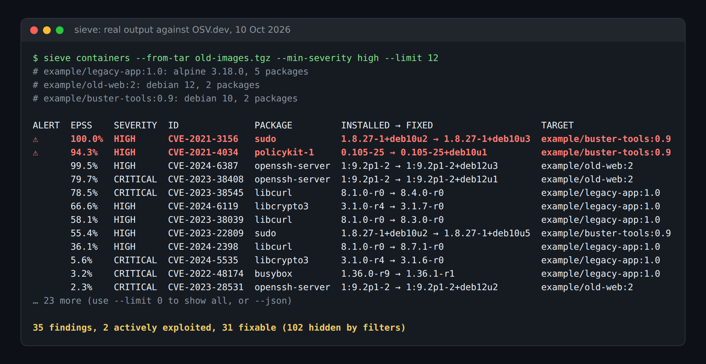
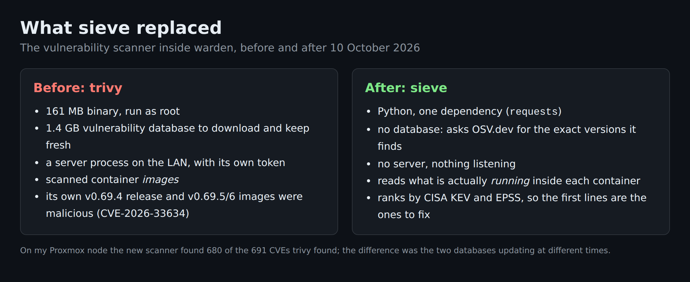
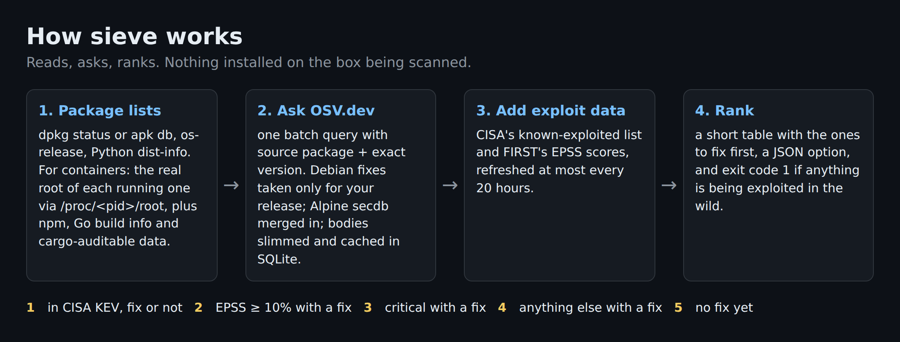

# sieve

Find the CVEs that matter on a Linux box and its running containers.

No scanner binary, no 1.4 GB database, no server: sieve reads the package lists already on the box, asks
[OSV.dev](https://osv.dev) which advisories affect those exact versions, then ranks the results by
[CISA KEV](https://www.cisa.gov/known-exploited-vulnerabilities-catalog) and [EPSS](https://www.first.org/epss/).
Its only dependency is `requests`.



## Why



sieve started as the scanner inside [warden](https://github.com/casareanderson/warden), where it replaced trivy on
10 October 2026. Trivy's v0.69.4 release and its v0.69.5 and v0.69.6 images were malicious (CVE-2026-33634), and the
scanner you run as root to find supply-chain problems shouldn't be a supply-chain problem itself.

OSV.dev is the open database behind Google's osv-scanner. Debian, Ubuntu, Alpine, the GitHub advisory database,
PyPA, the Go team and RustSec all publish to it directly, so there is nothing to download, verify or keep patched
on your side.

## Install

```
pipx install git+https://github.com/casareanderson/sieve
```

Python 3.10 or newer. It also runs straight from a checkout: `python3 -m sieve host`.

### Docker

The image only needs to read the host's filesystem, so mount it read-only and point `--root` at it:

```
docker run --rm -v /:/host:ro ghcr.io/casareanderson/sieve host --root /host
```

Add `-v sieve-cache:/home/sieve/.cache` to keep the advisory cache between runs. The image runs as an
unprivileged user; package databases are world-readable, so host scans don't need root.

The image can't scan running containers itself: that needs the docker CLI and root on the Docker host. Run the
collector there instead (it's standard-library Python) and pipe its output into the image:

```
docker run --rm ghcr.io/casareanderson/sieve collector | sudo python3 - \
  | docker run --rm -i ghcr.io/casareanderson/sieve containers --from-tar -
```

## Usage

```
sieve host          # this machine: dpkg or apk packages, plus Python packages pip installed outside the OS
sieve containers    # every running Docker container on this machine (needs root)
sieve all           # both
```

Options (for `host`, `containers` and `all`):

| option | what it does |
|---|---|
| `--json` | machine-readable output |
| `--min-severity low\|medium\|high\|critical` | hide findings below this severity (known-exploited findings are always shown) |
| `--kev-only` | only findings in CISA's known-exploited list |
| `--fixable-only` | only findings with a fixed version available |
| `--cache PATH` | advisory cache, default `~/.cache/sieve/sieve.db`; the KEV and EPSS files are kept next to it |
| `--no-epss` | don't download or use EPSS scores |
| `--kernel` | also check kernel packages (skipped by default, see Limits) |
| `--root PATH` | `host` and `all`: read the host's packages from this directory instead of `/` (for example the host's `/` mounted at `/host` in a container) |
| `--limit N` | table rows to print, default 50, `0` for all; the summary line always counts everything |

Exit codes: `1` if any known-exploited (KEV) finding is in the output, `2` if part of the scan failed, otherwise
`0`. Filters apply first, so `sieve all --fixable-only` in cron or CI fails only on KEV findings you can actually fix.

### Examples

A fully patched Debian 13 host. Nothing is fixable, which is normal: most of what any scanner reports is "affected,
no fix released yet", and Debian marks a lot of it as unimportant.

```
$ sieve host --limit 8
# host: debian 13, 811 packages

KEV  EPSS   SEVERITY  ID              PACKAGE              INSTALLED → FIXED                          TARGET
     73.3%  UNKNOWN   CVE-2011-3389   gnutls-bin           3.8.9-3+deb13u4 → no fix                   host
     73.3%  UNKNOWN   CVE-2011-3389   libgnutls-dane0t64   3.8.9-3+deb13u4 → no fix                   host
     73.3%  UNKNOWN   CVE-2011-3389   libgnutls30t64       3.8.9-3+deb13u4 → no fix                   host
     20.9%  LOW       CVE-2019-6110   openssh-client       1:10.0p1-7+deb13u4 → unimportant (Debian)  host
     20.9%  LOW       CVE-2019-6110   openssh-server       1:10.0p1-7+deb13u4 → unimportant (Debian)  host
     20.9%  LOW       CVE-2019-6110   openssh-sftp-server  1:10.0p1-7+deb13u4 → unimportant (Debian)  host
     20.9%  LOW       CVE-2019-6110   ssh                  1:10.0p1-7+deb13u4 → unimportant (Debian)  host
     13.0%  LOW       CVE-2020-15778  openssh-client       1:10.0p1-7+deb13u4 → unimportant (Debian)  host
… 1957 more (use --limit 0 to show all, or --json)

1965 findings, 0 actively exploited, 0 fixable
```

Three deliberately old package lists (Alpine 3.18, Debian 12 at release, Debian 10), fed in with `--from-tar`:

```
$ sieve containers --from-tar old-images.tgz --min-severity high --limit 12
# example/legacy-app:1.0: alpine 3.18.0, 5 packages
# example/old-web:2: debian 12, 2 packages
# example/buster-tools:0.9: debian 10, 2 packages

KEV  EPSS    SEVERITY  ID              PACKAGE         INSTALLED → FIXED                    TARGET
⚠    100.0%  HIGH      CVE-2021-3156   sudo            1.8.27-1+deb10u2 → 1.8.27-1+deb10u3  example/buster-tools:0.9
⚠    94.3%   HIGH      CVE-2021-4034   policykit-1     0.105-25 → 0.105-25+deb10u1          example/buster-tools:0.9
     99.5%   HIGH      CVE-2024-6387   openssh-server  1:9.2p1-2 → 1:9.2p1-2+deb12u3        example/old-web:2
     79.7%   CRITICAL  CVE-2023-38408  openssh-server  1:9.2p1-2 → 1:9.2p1-2+deb12u1        example/old-web:2
     78.5%   CRITICAL  CVE-2023-38545  libcurl         8.1.0-r0 → 8.4.0-r0                  example/legacy-app:1.0
     66.6%   HIGH      CVE-2024-6119   libcrypto3      3.1.0-r4 → 3.1.7-r0                  example/legacy-app:1.0
     58.1%   HIGH      CVE-2023-38039  libcurl         8.1.0-r0 → 8.3.0-r0                  example/legacy-app:1.0
     55.4%   HIGH      CVE-2023-22809  sudo            1.8.27-1+deb10u2 → 1.8.27-1+deb10u5  example/buster-tools:0.9
     36.1%   HIGH      CVE-2024-2398   libcurl         8.1.0-r0 → 8.7.1-r0                  example/legacy-app:1.0
     5.6%    CRITICAL  CVE-2024-5535   libcrypto3      3.1.0-r4 → 3.1.6-r0                  example/legacy-app:1.0
     3.2%    CRITICAL  CVE-2022-48174  busybox         1.36.0-r9 → 1.36.1-r1                example/legacy-app:1.0
     2.3%    CRITICAL  CVE-2023-28531  openssh-server  1:9.2p1-2 → 1:9.2p1-2+deb12u2        example/old-web:2
… 23 more (use --limit 0 to show all, or --json)

35 findings, 2 actively exploited, 31 fixable (102 hidden by filters)
```

### Scanning containers on another machine

The container collector is a single standard-library script. It reads, it doesn't install or write anything,
and it doesn't need sieve on the Docker host:

```
sieve collector | ssh root@dockerhost python3 - > packages.tgz
sieve containers --from-tar packages.tgz
```

`--from-tar -` reads the tar from stdin.

### JSON

`--json` prints `targets` (what was scanned, OS, package count, status, notes), `errors`, `summary` and
`findings`. Each finding has `id` (the CVE where there is one), `package`, `installed`, `fixed` (empty when there
is no fix), `severity`, `kev`, `epss`, `epss_percentile`, `tier`, `status`, `target`, `summary`, `details` and `url`.

## How it works



**Package lists.** For the host: `/var/lib/dpkg/status` or `/lib/apk/db/installed`, `/etc/os-release`, and every
`*.dist-info`/`*.egg-info` under the system Python site directories. Python packages that dpkg or apk installed
are left to the distro's advisories, which know about backported fixes. For containers: the collector finds each
image with a running container and reads its real root filesystem through `/proc/<pid>/root`, skipping mounted
volumes. From each image it takes the OS package database, Python and npm package metadata, the build info
embedded in Go binaries, and the dependency list Rust binaries carry when built with `cargo-auditable`.

**Matching.** Debian and Alpine packages are queried by source package and reported by binary package, so you
see what to upgrade. Version comparisons follow each ecosystem's own rules (dpkg, apk, and semver/PEP 440 for
language packages). Debian records also list the fix in unstable, so sieve only uses fixes for your exact
release. Alpine's own secdb is merged in because OSV's Alpine import can lag behind it. Advisory bodies are cut
down to what matching needs before they're cached, because Ubuntu and Debian records list every affected version
of every binary and the full bodies ran a scan past 5 GB of memory.

**Ranking.** Known-exploited first, then what is likely to be exploited and can be fixed:

1. in CISA KEV (known exploited in the wild), fix or not
2. EPSS of 10% or more (at least a 1 in 10 chance of exploitation in the next 30 days) with a fix available
3. CRITICAL with a fix available
4. anything else with a fix
5. no fix yet

Within a tier, higher EPSS comes first, then higher severity. Severity is the vendor's rating where there is one
(Ubuntu priority, GitHub's reviewed level), otherwise the CVSS v3 base score; when an advisory has neither, sieve
borrows the rating from the GitHub, CVE, Ubuntu or Debian record for the same CVE.

**Caching.** Advisories are cached in SQLite and refetched only when OSV's `modified` stamp changes. KEV and EPSS
are downloaded at most every 20 hours; if a download fails, the last copy is used and a warning is printed.

## Limits

- **Forks, renamed and vendored packages are invisible.** sieve only knows what a package database or metadata
  file says. A library copied into a project, a binary built from a fork, or a package renamed by its publisher
  won't match an advisory.
- **OSV import lag.** Advisories reach OSV after the source publishes them, usually within hours, sometimes days.
  Alpine's secdb is merged in to cover the worst of it.
- **Kernel packages are skipped by default.** Containers and LXC guests run the host's kernel, and kernel
  advisories are numerous and large. Use `--kernel` on a real host if you want them. Vendor kernels such as
  Proxmox's `proxmox-kernel-*` aren't in any distro feed, so they're never covered.
- **Containers need root.** Container roots under `/proc/<pid>/root` are root-only. Only images with a running
  container are scanned.
- **Supported OS feeds:** Debian, Ubuntu (and distributions that declare `ID_LIKE=ubuntu`) and Alpine. Others
  (Fedora, RHEL, Arch, ...) get their Python and container language packages checked, not their OS packages.
- **Go binaries built before Go 1.18** store their build info differently and are counted but not read.
- Ubuntu fixes that only exist in Ubuntu Pro (ESM) are shown as "fix needs Ubuntu Pro (ESM)", not as fixable.
- The advisory data comes from OSV.dev, KEV from CISA and EPSS from FIRST, so scanning needs outbound HTTPS to
  `api.osv.dev`, `secdb.alpinelinux.org`, `www.cisa.gov` and `epss.empiricalsecurity.com`. Package names and
  versions are sent to OSV.dev; nothing else about the machine is.

## Relationship to warden

sieve is the scanner inside warden, on its own. warden adds the parts that need a server: scanning many machines
over SSH, history, a console, alerts and patching. If you only want to know what to patch on one box, sieve is
enough.

## Development

```
python3 -m venv .venv && .venv/bin/pip install -e '.[test]'
.venv/bin/python -m pytest -q
```

The tests run offline; OSV is stubbed.

## Licence

AGPL-3.0, the same as warden. Copyright (C) 2026 casareanderson. See [LICENSE](LICENSE).
